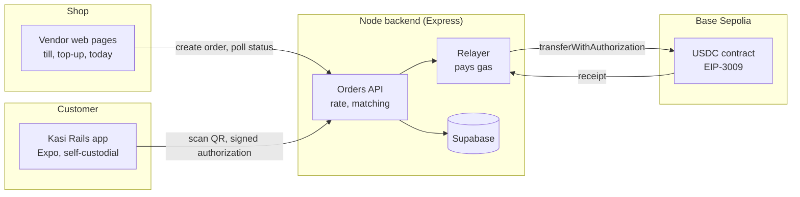

# Kasi Rails

Lets any spaza accept stablecoins as easily as cash, and sell them to customers who only have cash.

## Hackathon

Built for the **W3Node Node Engine Hackathon 2026**, **Merchant & Machine Payments** track.

## The problem

South Africa's corner shops run on cash. Spaza owners handle cash all day but earn nothing extra on it, and they can't take digital payments without card machines and merchant accounts that many of them can't get.

Customers who only have cash can't buy stablecoins without a bank account, an exchange login and crypto know-how.

Existing stablecoin checkouts assume the customer already holds crypto, and they end every sale with a sweep to a bank.

## The solution

The shop is both the till and the ramp.

- **Pay at the till.** The shop shows a QR code, the customer pays in USDC from the Kasi Rails app, and the shop sees **PAID** within seconds.
- **Buy USDC with cash.** The shop sells USDC from its float to cash customers, for a small fee.
- **Till income becomes float.** USDC taken at the till is the float for the next cash customer. A bank is only needed to rebalance.

## How it works

1. The shop keys in an amount in rand on the till page. The backend creates an order priced at the live USDC/ZAR rate and shows it as a QR code.
2. The customer scans the QR code in the Kasi Rails app and sees "Pay R85.00 to Mama Thoko's Spaza?".
3. The app signs a USDC transfer authorization on the phone. The private key never leaves the device.
4. The backend checks the authorization against the order and submits it to Base Sepolia through its relayer, which pays the gas.
5. Once the transaction is confirmed, the order is marked PAID and the till page turns green.



## Why it's gasless and auto-matched

- **Gasless.** The customer app signs a USDC [EIP-3009](https://eips.ethereum.org/EIPS/eip-3009) `transferWithAuthorization` message instead of sending a transaction. Our relayer submits it on-chain and pays the gas, so customers never need ETH.
- **Auto-matched.** The authorization's `nonce` is `keccak256(orderId)`. Every payment is cryptographically tied to exactly one order. USDC rejects a nonce the payer has already used, and the backend only accepts payment for a pending order, so an order can't be paid twice. There is no manual reconciliation: the backend knows which order a payment belongs to before it reaches the chain.

## Tech stack

- **Chain:** Base Sepolia (chain ID 84532)
- **Token:** test USDC `0x036CbD53842c5426634e7929541eC2318f3dCF7e` (6 decimals). The EIP-712 domain is read from the contract at runtime.
- **Web3:** viem
- **Backend:** Node + Express
- **Database:** Supabase (with an in-memory fallback for local runs)
- **Customer app:** Expo (React Native)
- **Rate:** VALR public API for the USDC/ZAR rate

## Repo structure

```
packages/shared   chain constants, USDC ABI fragments, types, helpers
apps/server       Express API, vendor pages (public/), scripts
apps/customer     Expo customer app
```

## Getting started

### Prerequisites

- Node.js 22+
- npm 10+

### Install

```sh
npm install
```

### Wallets

```sh
npm run setup:wallets
```

This creates `.env` from `.env.example` if needed and fills in the shop, relayer and customer keys. Existing valid keys are kept and keys are never printed. Use `-- --show` to print the addresses only, or `-- --force` to regenerate all three.

Fund the wallets on Base Sepolia:

- **USDC** from [faucet.circle.com](https://faucet.circle.com) (select Base Sepolia) for the shop and customer
- **ETH** from the [Coinbase Developer Platform faucet](https://portal.cdp.coinbase.com) (Faucets, then Base Sepolia) for the relayer (gas) and the shop

### Run

- Gasless payment spike: `npm run spike` sends 0.10 USDC from the customer to the shop. The customer signs, the relayer pays the gas, and the script prints the Basescan link and balances. Each order id can be paid once, so use `npm run spike -- --order spike-2` (and so on) to run it again.
- Server and till page: _coming soon_
- Customer app: _coming soon_

## Status

- [x] Milestone 1: scaffold, shared package, wallet tools
- [x] Milestone 2: gasless payment spike ([first transfer on Base Sepolia](https://sepolia.basescan.org/tx/0xa3805a9eba443c28d0b35bad5bcc02793c19334a1e03d7a992e9e5de56d27b3a))
- [ ] Milestone 3: server API and till page
- [ ] Milestone 4: customer app, end to end

## Roadmap

- Refunds and late payments
- Cash top-up
- Merchant dashboard
- Sepedi and isiZulu voice confirmation
- Passkey wallets
- ZARP (rand stablecoin)
- Cash-out via VALR or Kotani Pay
- Per-order deposit addresses

## Demo video

Link coming soon.

## Team

- Matome Tjale (team lead)
- Halaletsang Malefahlo
- Ntokozo Nkambule

## Testnet only

Kasi Rails runs on Base Sepolia with test tokens and never handles real funds. Never commit private keys: `.env` is git-ignored, and `npm run setup:wallets` refuses to write keys if it isn't.
